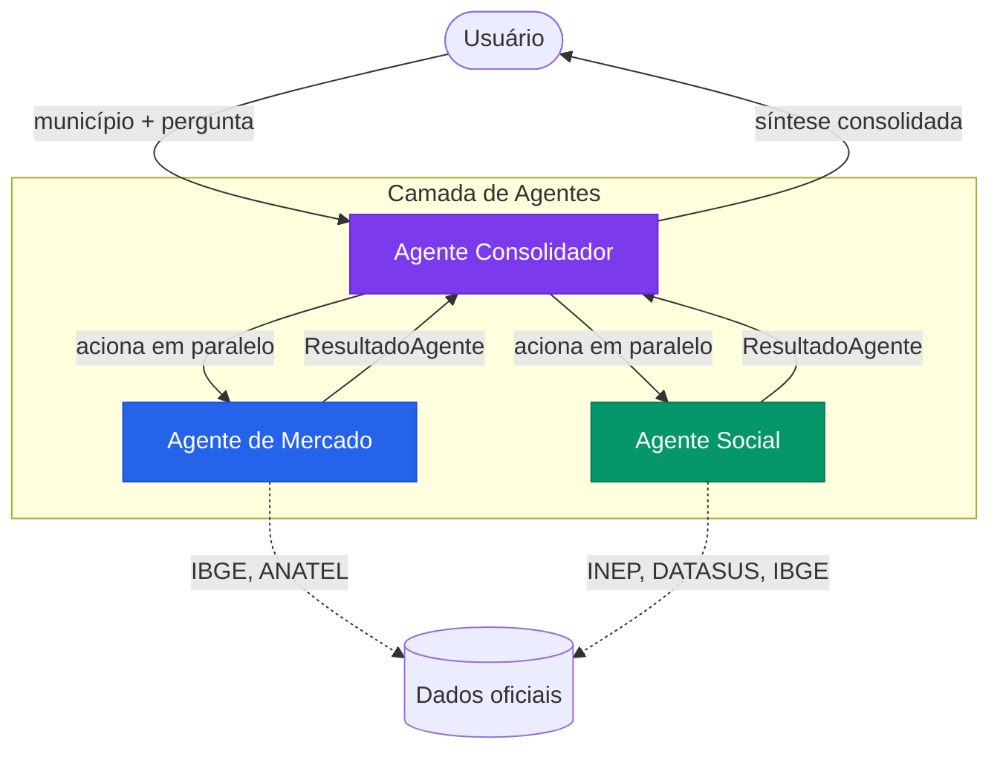

<div align="center">
  

  # NEXORA

  **Conectividade orientada por dados reais**

  Plataforma de inteligência territorial com IA agêntica para análise de oportunidades de expansão da conectividade nos 645 municípios do Estado de São Paulo.

  
  
  
  
  
  

</div>

---

## Sobre o projeto

O NEXORA é uma plataforma de inteligência territorial baseada em IA agêntica, desenvolvida para apoiar decisões estratégicas de expansão da conectividade nos municípios paulistas.

A plataforma investiga cada município por dois pilares de igual importância:

| Pilar | Foco |
|---|---|
| **Potencial de Mercado** | Características econômicas e demográficas, indicadores de telefonia móvel e internet fixa, presença de operadoras e oportunidades comerciais (IBGE, ANATEL) |
| **Potencial Social** | Indicadores educacionais, de saúde e vulnerabilidade social, lacunas de acesso, perfil urbano e rural, impacto da conectividade (INEP, DATASUS, IBGE) |

Nenhum pilar tem prioridade sobre o outro. As análises são apresentadas em paralelo, com fontes, períodos de referência e limitações metodológicas sempre à vista.

**Problema:** expansões de conectividade frequentemente se baseiam apenas em viabilidade comercial, ignorando municípios com alta necessidade social e baixa atratividade de mercado imediata — e vice-versa.

**Público-alvo:** equipes de estratégia, analistas territoriais e gestores de expansão em empresas de telecomunicações e órgãos públicos.

---

## Objetivos

- Oferecer uma visão equilibrada entre potencial de mercado e potencial social da conectividade.
- Fundamentar decisões de expansão em dados oficiais, com rastreabilidade completa.
- Democratizar o acesso à análise territorial por meio de interface acessível e intuitiva.
- Identificar municípios com necessidade social elevada que seriam invisíveis em análises puramente comerciais.
- Garantir transparência sobre limitações e ausência de dados, sem preencher lacunas com suposições.

---

## Funcionalidades

### Implementadas

| Funcionalidade | Descrição |
|---|---|
| **Dashboard** | Visão geral da plataforma com estatísticas, acesso às funcionalidades e nota de integridade dos dados |
| **Mapa Territorial** | Mapa interativo dos 645 municípios paulistas com busca por nome, seleção no mapa e acesso ao perfil |
| **Perfil Municipal** | Indicadores detalhados por município nos pilares Mercado e Social, com fonte, período, tipo e limitações |
| **Comparação** | Comparação lado a lado de até 4 municípios, com alternância entre pilares e destaque do melhor valor |
| **Investigação por IA** | Análise agêntica por município: três agentes especializados investigam em paralelo e o Consolidador sintetiza |
| **Tema claro/escuro** | Alternância de tema com preferência salva localmente |

### Comportamento dos indicadores

Cada indicador é classificado quanto à sua origem:

- `Oficial` — dado direto de fonte governamental
- `Calculado` — derivado de operações sobre dados oficiais
- `Estimado` — projeção por coeficiente metodológico
- `Interpretado` — inferência fundamentada
- `Indisponível` — dado não encontrado (nunca substituído por zero)

---

## Arquitetura dos agentes de IA

O NEXORA utiliza três agentes especializados que operam sobre a API GroqCloud:

### Agente de Mercado
Investiga o potencial comercial da conectividade: características econômicas e demográficas, indicadores ANATEL de telefonia móvel e internet fixa, presença de operadoras e oportunidades de expansão. Opera com dados do IBGE e ANATEL. Nunca inventa indicadores — ausências são declaradas explicitamente.

### Agente Social
Investiga necessidades e impactos sociais da conectividade: indicadores educacionais (INEP), de saúde (DATASUS), vulnerabilidade social, perfil urbano/rural e lacunas de inclusão digital. Identifica municípios com alta necessidade, independentemente da atratividade comercial.

### Agente Consolidador
Orquestra a investigação completa. Aciona Mercado e Social em paralelo, recebe seus resultados, verifica coerência das evidências, identifica convergências e divergências entre os pilares e produz uma síntese equilibrada. Nunca simplesmente concatena as respostas — analisa e integra.



O fluxo de investigação também implementa **cache local** (SQLite): respostas para o mesmo município e pergunta são reutilizadas, evitando chamadas desnecessárias à API.

---

## Fontes de dados

| Fonte | Uso no NEXORA | Integração |
|---|---|---|
| [IBGE](https://www.ibge.gov.br/) | Cadastro de municípios, população, densidade, PIB per capita | Dados incorporados ao banco local via seed |
| [ANATEL](https://www.gov.br/anatel/pt-br/dados) | Indicadores de telefonia móvel, internet fixa, cobertura e provedores | Referenciada pelos agentes nas análises |
| [INEP](https://www.gov.br/inep/pt-br/acesso-a-informacao/dados-abertos) | Indicadores educacionais (IDEB, número de escolas, acesso à tecnologia) | Referenciada pelo Agente Social |
| [DATASUS](https://datasus.saude.gov.br/) | Cobertura de serviços de saúde, indicadores de vulnerabilidade social | Referenciada pelo Agente Social |

> As fontes são referenciadas pelos agentes durante as análises. A integração direta via API é prevista em etapas futuras do projeto; atualmente os indicadores são calculados e estimados a partir dos dados cadastrais disponíveis.

---

## Tecnologias

### Frontend

| Tecnologia | Versão | Função |
|---|---|---|
| React | 19 | Interface de usuário |
| TypeScript | 7.0 | Tipagem estática |
| Vite | 8 | Bundler e servidor de desenvolvimento |
| React Router | 7 | Navegação entre páginas |
| Motion | 14 | Animações e transições |
| Leaflet | 1.9 | Mapa interativo |
| Recharts | 3 | Gráficos e visualizações de dados |
| Lucide React | 1.6 | Biblioteca de ícones |
| Axios | 1.2 | Cliente HTTP |
| Zod | 4 | Validação de schemas |

### Backend

| Tecnologia | Versão | Função |
|---|---|---|
| Python | 3.12+ | Linguagem do servidor |
| FastAPI | 0.162 | Framework da API REST |
| Pydantic | v2 | Validação e serialização de dados |
| pydantic-settings | 2.16 | Gerenciamento de configurações via `.env` |
| aiosqlite | 0.22 | Acesso assíncrono ao banco de dados |
| aiohttp | 3.14 | Cliente HTTP assíncrono |
| uvicorn | 0.54 | Servidor ASGI |

### Inteligência Artificial

| Tecnologia | Uso |
|---|---|
| GroqCloud | Inferência dos três agentes de IA (Mercado, Social e Consolidador) |

A chave de API GroqCloud é configurada exclusivamente no arquivo `.env` do backend. O frontend **nunca recebe, armazena ou transmite** credenciais.

### Banco de dados

- **SQLite** — banco local, persistido em `backend/nexora.db`
- Populado via scripts de seed com os 645 municípios do Estado de São Paulo
- Também utilizado para cache das respostas dos agentes

### Testes

| Ferramenta | Escopo |
|---|---|
| Vitest + Testing Library | Testes unitários do frontend |
| Playwright | Testes E2E do frontend |
| Pytest + pytest-asyncio | Testes do backend (rotas, agentes, cache) |

---

## Identidade visual e Design System

### Paleta de cores

A paleta foi construída ao redor dos dois pilares da plataforma e do sistema de IA, com variantes claras e escuras para cada um.

**Cores neutras**

| Token | HEX (light) | Uso |
|---|---|---|
| `--color-ink` | `#1a2332` | Texto principal |
| `--color-paper` | `#f4f6f8` | Fundo da aplicação |
| `--color-card` | `#ffffff` | Superfície de cards |
| `--color-line` | `#e2e8f0` | Bordas e divisores |
| `--color-muted` | `#64748b` | Texto secundário |
| `--color-highlight` | `#eef2f7` | Fundo de destaques sutis |

**Pilar Mercado (azul)**

| Token | HEX | Uso |
|---|---|---|
| `--color-market` | `#2563eb` | Cor principal do pilar Mercado |
| `--color-market-dk` | `#1d4ed8` | Hover e gradiente |
| `--color-market-mid` | `#3b82f6` | Variante intermediária |
| `--color-market-lt` | `#eff6ff` | Fundos de cards de Mercado |

**Pilar Social (verde-esmeralda)**

| Token | HEX | Uso |
|---|---|---|
| `--color-social` | `#059669` | Cor principal do pilar Social |
| `--color-social-dk` | `#047857` | Hover e gradiente |
| `--color-social-mid` | `#10b981` | Variante intermediária |
| `--color-social-lt` | `#ecfdf5` | Fundos de cards de Social |

**IA / Consolidador (violeta)**

| Token | HEX | Uso |
|---|---|---|
| `--color-ai` | `#7c3aed` | Cor do Agente Consolidador |
| `--color-ai-dk` | `#6d28d9` | Hover e gradiente |
| `--color-ai-lt` | `#f5f3ff` | Fundo do bloco de IA |

**Estados**

| Token | HEX | Uso |
|---|---|---|
| `--color-warn` | `#d97706` | Alertas, dados estimados, ausências |
| `--color-error` | `#dc2626` | Erros |

**Hero (gradiente)**

```
linear-gradient(135deg, #1e3a5f 0%, #1a5276 40%, #0e6655 100%)
```

O gradiente do hero parte do azul-marinho profundo (mercado) e transita para o verde-escuro (social), unificando os dois pilares visualmente.

### Tipografia

- **Família principal:** `Inter` (Google Fonts) — aplicada em todos os textos, títulos e rótulos
- **Família mono:** `JetBrains Mono` / `Fira Code` — reservada para valores de indicadores e códigos técnicos
- **Escala de tamanhos:** de `0.70rem` (labels menores) até `2.5rem` (títulos de hero)
- **Line-height:** `1.2` (títulos), `1.4` (subtítulos), `1.6` (corpo de texto)

### Componentes e padrões visuais

**Cards de funcionalidade**
Cards com borda lateral colorida por pilar, ícone em destaque, título, descrição e seta de navegação. Cor do acento determinada pelo pilar: `--color-market` ou `--color-social`.

**Tabs de pilar**
Botões de alternância entre Mercado e Social com marcador colorido animado para o tab ativo. Presente em Perfil Municipal, Comparação e Investigação.

**Cards de indicador**
Cada indicador exibe nome, valor formatado, unidade, fonte, período e badge de tipo. Indicadores indisponíveis são marcados explicitamente com `N/D` — nunca com zero ou traço.

**Tabela comparativa**
Tabela responsiva com rolagem horizontal. A célula com o maior valor numérico válido entre os municípios comparados recebe destaque (`✦`).

**Badges de tipo**
Badges coloridas indicam a origem de cada indicador: `Oficial`, `Calculado`, `Estimado`, `Interpretado` ou `Indisponível`.

### Ícones e animações

- **Lucide React** — biblioteca unificada de ícones SVG. Usada em toda a navegação, cards, botões e indicadores.
- **Motion (Framer Motion)** — animações de entrada com `fadeUp` (y + opacity), `scaleIn` e `staggerChildren` para listas. Transições de tab com `layoutId` para indicador animado. `AnimatePresence` em todos os elementos que aparecem e desaparecem condicionalmente.
- **CSS keyframes globais** — `fadeIn`, `fadeUp`, `fadeDown`, `scaleIn`, `shimmer` (skeleton loader).
- **Respeito ao `prefers-reduced-motion`** — todas as animações são desabilitadas automaticamente quando o sistema operacional solicita.

### Layout

- **Barra superior fixa** (`60px`) com logo, navegação principal e toggle de tema.
- **Conteúdo centralizado** com `max-width: 1280px`.
- **Painel lateral** em páginas como Mapa (`360px`).
- **Grade responsiva** nos cards do dashboard (1 a 4 colunas conforme viewport).
- **Tema escuro nativo** via `prefers-color-scheme` e atributo `data-theme` no `<html>`.

---

## Estrutura do repositório

```
NEXORA/
├── frontend/
│   ├── public/
│   │   ├── nexora-icon.svg        # Logo e favicon da aplicação
│   │   └── sp_municipios.geojson  # GeoJSON dos municípios paulistas
│   ├── src/
│   │   ├── components/
│   │   │   ├── layout/            # AppLayout, TopBar
│   │   │   └── ui/                # Spinner, Card, Badge, EmptyState, ErrorState
│   │   ├── e2e/                   # Testes E2E Playwright
│   │   ├── lib/                   # Cliente HTTP (axios)
│   │   ├── pages/                 # Dashboard, Mapa, Perfil, Comparar, Investigar
│   │   ├── styles/                # Design tokens e CSS global
│   │   ├── test/                  # Testes unitários Vitest
│   │   └── types/                 # Tipos TypeScript
│   ├── index.html
│   ├── vite.config.ts
│   └── package.json
├── backend/
│   ├── app/
│   │   ├── agents/                # AgenteMarket, AgenteSocial, AgenteConsolidador
│   │   ├── api/routes/            # health, municipios, groq, investigar
│   │   ├── db/                    # database.py, seed.py, seed_indicadores.py
│   │   ├── services/              # groq_client.py, agent_cache.py
│   │   ├── config.py              # Configurações via pydantic-settings
│   │   └── main.py                # App FastAPI
│   ├── tests/                     # Testes pytest
│   ├── .env.example               # Modelo de variáveis de ambiente
│   ├── requirements.txt
│   └── run.py
└── README.md
```

---

## Instalação e execução local

### Pré-requisitos

- Python 3.12 ou superior
- Node.js 20 ou superior
- Chave de API GroqCloud (`GROQ_API_KEY`)

### 1. Clonar o repositório

```bash
git clone <url-do-repositorio>
cd NEXORA
```

### 2. Configurar o backend

```bash
cd backend

# Criar e ativar o ambiente virtual
python -m venv .venv
.venv\Scripts\activate          # Windows
# source .venv/bin/activate     # Linux / macOS

# Instalar dependências
pip install -r requirements.txt

# Configurar variáveis de ambiente
copy .env.example .env
# Editar .env e inserir sua GROQ_API_KEY
```

**Variáveis obrigatórias no `.env`:**

```env
GROQ_API_KEY=gsk_sua_chave_aqui
APP_HOST=127.0.0.1
APP_PORT=8000
CORS_ORIGIN=http://localhost:5173
DB_PATH=./nexora.db
```

> A chave `GROQ_API_KEY` deve permanecer **exclusivamente no arquivo `.env` do backend**, que está listado no `.gitignore`. Nunca a inclua em código-fonte, commits ou no frontend.

### 3. Popular o banco de dados

```bash
# Municípios (execução única)
python -m app.db.seed

# Indicadores de Mercado e Social (execução única)
python -m app.db.seed_indicadores
```

### 4. Iniciar o backend

```bash
python run.py
# API disponível em: http://127.0.0.1:8000
# Documentação interativa em: http://127.0.0.1:8000/api/docs
```

### 5. Configurar e iniciar o frontend

```bash
cd ../frontend
npm install
npm run dev
# Interface disponível em: http://localhost:5173
```

### 6. Executar os testes

```bash
# Testes unitários do frontend
cd frontend
npm test

# Testes E2E (requer frontend em execução)
npm run test:e2e

# Testes do backend
cd ../backend
python -m pytest tests/ -v
```

---

## Segurança

- Credenciais ficam **exclusivamente** no arquivo `backend/.env`, que está listado no `.gitignore`.
- Chaves GroqCloud são carregadas como `SecretStr` (Pydantic) — nunca aparecem em logs, `repr()` ou respostas da API.
- O frontend **nunca recebe, armazena nem transmite** credenciais ou chaves de API.
- O arquivo `.env.example` contém apenas nomes de variáveis e valores fictícios — é seguro versionar.

---

## Convenções de commit

Mensagens em **português**, no imperativo presente, com prefixo indicando a natureza da alteração.

| Prefixo | Quando usar |
|---|---|
| `feat` | Nova funcionalidade |
| `fix` | Correção de bug |
| `chore` | Configuração, dependências, scaffold |
| `docs` | Documentação, README |
| `style` | Ajustes visuais e CSS |
| `refactor` | Melhoria de código sem alterar comportamento |
| `test` | Testes |
| `perf` | Melhoria de desempenho |
| `db` | Banco de dados e dados |
| `agent` | Agentes de IA |
| `api` | Endpoints e contratos da API |
| `security` | Segurança |

---

## Branches

| Branch | Finalidade |
|---|---|
| `main` | Versão estável e validada |
| `pietro` | Desenvolvimento ativo |

Toda implementação ocorre na branch `pietro`. A integração com `main` é feita gradualmente, mediante revisão explícita.

---

## Equipe

Projeto desenvolvido para apresentação institucional a representantes da IBM e da Fundação Telefônica, com foco em inteligência territorial e inclusão digital.

---

<div align="center">
  <sub>NEXORA — Inteligência Territorial · Estado de São Paulo</sub>
</div>
