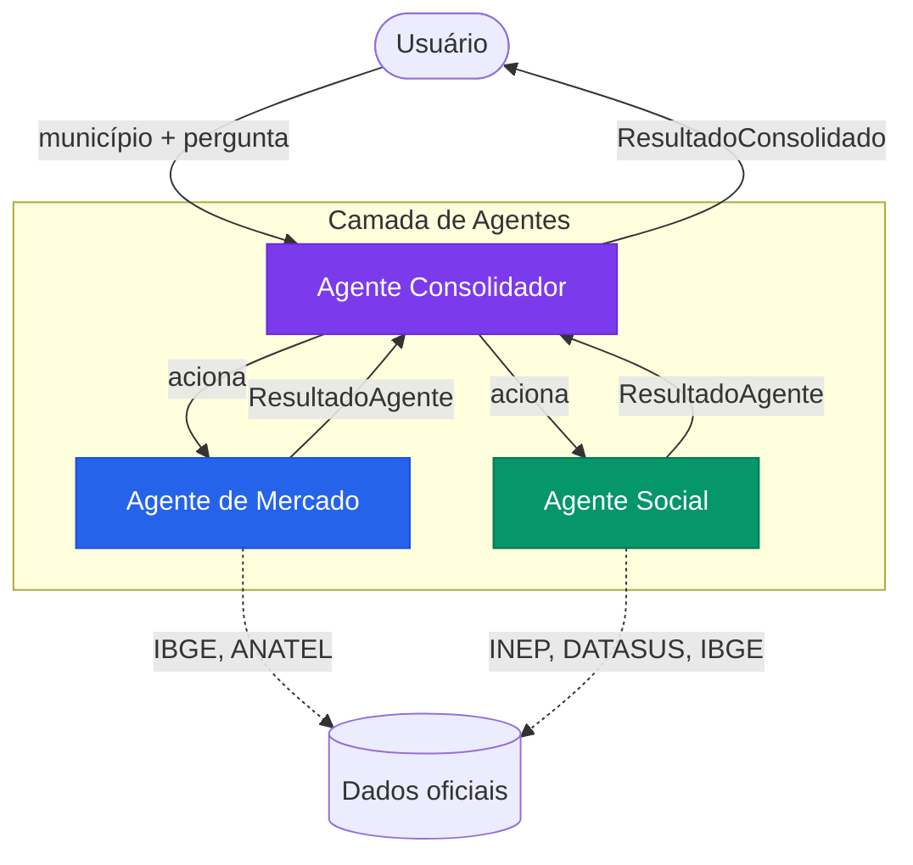

<div align="center">
  

  # NEXORA

  **Conectividade orientada por dados reais**

  Plataforma de inteligência territorial com IA agêntica para análise de oportunidades de expansão da conectividade nos 645 municípios do Estado de São Paulo.

  
  
  
  
  
  
  
  

</div>

---

## Sobre o projeto

O NEXORA é uma plataforma de inteligência territorial baseada em IA agêntica, desenvolvida para apoiar decisões estratégicas de expansão da conectividade nos municípios paulistas.

A plataforma investiga cada município por dois pilares de igual importância:

| Pilar | Foco |
|---|---|
| **Potencial de Mercado** | Características econômicas e demográficas, indicadores de telefonia móvel e internet fixa, presença de operadoras e oportunidades comerciais (IBGE, ANATEL) |
| **Potencial Social** | Indicadores educacionais, de saúde e vulnerabilidade social, lacunas de acesso, perfil urbano e rural, impacto da conectividade (INEP, DATASUS, IBGE) |

Nenhum pilar tem prioridade sobre o outro. As análises são apresentadas em paralelo, com fontes, períodos de referência e limitações metodológicas sempre à vista.

**Problema:** expansões de conectividade frequentemente se baseiam apenas em viabilidade comercial, ignorando municípios com alta necessidade social e baixa atratividade de mercado imediata — e vice-versa.

**Público-alvo:** equipes de estratégia, analistas territoriais e gestores de expansão em empresas de telecomunicações e órgãos públicos.

---

## Funcionalidades

| Funcionalidade | Descrição |
|---|---|
| **Mapa Territorial** | Mapa interativo dos 645 municípios paulistas full-screen com busca, seleção, drawer mobile e comparação visual por cores |
| **Dashboard** | Visão geral com estatísticas da plataforma, histórico da última análise de IA e rankings de indicadores |
| **Perfil Municipal** | Indicadores detalhados por município nos pilares Mercado e Social, com fonte, período, tipo e limitações |
| **Comparação** | Comparação lado a lado de até 3 municípios, com alternância entre pilares e destaque do melhor valor |
| **Chat IA (FAB)** | Assistente flutuante que aciona os três agentes, suporta análise de múltiplos municípios em sequência e salva o histórico localmente |
| **Análises Recentes** | Histórico das investigações salvo no localStorage, com síntese, viabilidade financeira, financiamentos e programas elegíveis |
| **Tema claro/escuro** | Alternância com preferência persistida no localStorage e respeito ao `prefers-color-scheme` |

### Comportamento dos indicadores

Cada indicador é classificado quanto à sua origem:

| Badge | Significado |
|---|---|
| `Oficial` | Dado direto de fonte governamental |
| `Calculado` | Derivado de operações sobre dados oficiais |
| `Estimado` | Projeção por coeficiente metodológico |
| `Interpretado` | Inferência fundamentada pelo agente |
| `Indisponível` | Dado não encontrado — nunca substituído por zero |

---

## Arquitetura dos agentes de IA

O NEXORA utiliza três agentes especializados que operam sobre a API GroqCloud:

### Agente de Mercado
Investiga o potencial comercial da conectividade: características econômicas e demográficas, indicadores ANATEL de telefonia móvel e internet fixa, estimativas de custo de implantação (FTTH, WISP, LTE rural) e classificação de retorno. Opera com dados do IBGE e ANATEL. Nunca inventa indicadores — ausências são declaradas explicitamente.

### Agente Social
Investiga necessidades e impactos sociais da conectividade: indicadores educacionais (INEP), de saúde (DATASUS), vulnerabilidade social, perfil urbano/rural e elegibilidade a programas públicos (PNBL, GESAC, FUST, EduConecta). Identifica municípios com alta necessidade, independentemente da atratividade comercial.

### Agente Consolidador
Orquestra a investigação completa. Aciona Mercado e Social em sequência, recebe seus resultados, verifica coerência das evidências, identifica convergências e divergências entre os pilares e produz síntese técnico-executiva com recomendação objetiva para o analista (`RECOMENDADO / RECOMENDADO COM RESSALVAS / NÃO RECOMENDADO`). Nunca simplesmente concatena as respostas — analisa e integra.



O fluxo implementa **cache local** (SQLite, TTL 24h): respostas para o mesmo município e pergunta são reutilizadas, evitando chamadas desnecessárias à API.

### Validação e coerção de tipos

Os schemas Pydantic possuem validators robustos que normalizam as respostas da IA independentemente do formato retornado:

- **`TipoDado`** — aceita maiúsculas, femininos (`"calculada"`, `"estimada"`) e aliases (`"n/a"`, `"unavailable"`)
- **`ViabilidadeFinanceira.financiamentos_disponiveis`** — `list[str]`; aceita lista nativa, string CSV (`"FUST, BNDES"`) ou string JSON (`'["FUST","BNDES"]'`)
- **`CustoEstimado`** — campos float aceitam string formatada em BR (`"R$ 2.500.000"`, `"2,5M"`, `"500K"`)
- **`ImpactoEstimado`** — campos string aceitam `int`, `float` e `list` retornados pela IA
- Respostas parcialmente válidas são preservadas — um campo inválido não descarta a análise inteira

---

## Fontes de dados

| Fonte | Uso no NEXORA |
|---|---|
| [IBGE](https://www.ibge.gov.br/) | Cadastro de municípios, população, densidade, PIB per capita |
| [ANATEL](https://www.gov.br/anatel/pt-br/dados) | Indicadores de telefonia móvel, internet fixa, cobertura e provedores |
| [INEP](https://www.gov.br/inep/pt-br/acesso-a-informacao/dados-abertos) | Indicadores educacionais (IDEB, número de escolas, acesso à tecnologia) |
| [DATASUS](https://datasus.saude.gov.br/) | Cobertura de serviços de saúde, indicadores de vulnerabilidade social |

> Os indicadores são calculados e estimados a partir dos dados cadastrais disponíveis. A integração direta via API das fontes é prevista em etapas futuras.

---

## Tecnologias

### Frontend

| Tecnologia | Versão | Função |
|---|---|---|
| React | 19 | Interface de usuário |
| TypeScript | 7.0 | Tipagem estática |
| Vite | 8 | Bundler e servidor de desenvolvimento |
| React Router | 7 | Navegação entre páginas |
| Motion | 14 | Animações e transições |
| Leaflet | 1.9 | Mapa interativo |
| Recharts | 3 | Gráficos e visualizações de dados |
| Lucide React | 1.6 | Biblioteca de ícones |
| Axios | 1.2 | Cliente HTTP |

### Backend

| Tecnologia | Versão | Função |
|---|---|---|
| Python | 3.15+ | Linguagem do servidor |
| FastAPI | 0.162 | Framework da API REST |
| Pydantic | v2.14 | Validação e serialização de dados com coerção de tipos |
| pydantic-settings | 2.16 | Gerenciamento de configurações via `.env` |
| aiosqlite | 0.22 | Acesso assíncrono ao banco de dados |
| aiohttp | 3.14 | Cliente HTTP assíncrono |
| uvicorn | 0.54 | Servidor ASGI |

### Inteligência Artificial

| Modelo | Agente | Uso |
|---|---|---|
| `openai/gpt-oss-20b` | Mercado e Social | Análise especializada rápida |
| `openai/gpt-oss-120b` | Consolidador | Síntese e recomendação executiva |

A chave de API GroqCloud é configurada exclusivamente no arquivo `.env` do backend. O frontend **nunca recebe, armazena ou transmite** credenciais.

### Banco de dados

- **SQLite** — banco local, persistido em `backend/nexora.db`
- Populado via scripts de seed com os 645 municípios do Estado de São Paulo e seus indicadores
- Cache das respostas dos agentes com TTL de 24 horas

### Testes

| Ferramenta | Escopo | Total |
|---|---|---|
| Pytest + pytest-asyncio | Backend: rotas, agentes, cache, schemas, coerção de tipos | 138 testes |
| Vitest + Testing Library | Frontend: componentes e páginas | — |
| Playwright | E2E: fluxos completos de navegação | — |

---

## Estrutura do repositório

```
NEXORA/
├── frontend/
│   ├── public/
│   │   ├── nexora-icon.svg          # Logo e favicon
│   │   └── sp_municipios.geojson    # GeoJSON dos 645 municípios paulistas
│   └── src/
│       ├── components/
│       │   ├── layout/              # AppLayout (full-bleed para /mapa), TopBar
│       │   └── ui/                  # AIFab (chat IA), Badge, Card, Spinner…
│       ├── pages/                   # Início, Mapa, Dashboard, Comparar, Análises
│       ├── styles/                  # Design tokens (tokens.css) e CSS global
│       ├── test/                    # Testes unitários Vitest
│       ├── e2e/                     # Testes E2E Playwright
│       └── types/                   # Contratos TypeScript (espelham schemas do backend)
├── backend/
│   ├── app/
│   │   ├── agents/
│   │   │   ├── schemas.py           # Contratos Pydantic com validators de coerção
│   │   │   ├── market_agent.py      # Agente de Mercado
│   │   │   ├── social_agent.py      # Agente Social
│   │   │   └── consolidator_agent.py # Agente Consolidador
│   │   ├── api/routes/              # health, municipios, groq, investigar
│   │   ├── db/                      # database.py, seed.py, seed_indicadores.py
│   │   ├── services/                # groq_client.py, agent_cache.py
│   │   ├── config.py                # Configurações via pydantic-settings
│   │   └── main.py                  # App FastAPI
│   ├── tests/
│   │   ├── test_schema_validation.py # Coerção de tipos, TipoDado, listas, nulos
│   │   ├── test_agents.py            # Agentes Market, Social e Consolidador
│   │   ├── test_groq.py              # Cliente GroqCloud e endpoint /groq/validar
│   │   ├── test_investigar.py        # Endpoint /investigar
│   │   ├── test_municipios.py        # Endpoints de municípios
│   │   ├── test_perfil.py            # Endpoint de perfil municipal
│   │   ├── test_health.py            # Health check
│   │   └── test_agent_cache.py       # Cache de agentes
│   ├── .env.example
│   ├── requirements.txt
│   └── run.py
└── README.md
```

---

## Instalação e execução local

### Pré-requisitos

- Python 3.12 ou superior
- Node.js 20 ou superior
- Chave de API GroqCloud (`GROQ_API_KEY`) — obtenha gratuitamente em [console.groq.com](https://console.groq.com)

### 1. Clonar o repositório

```bash
git clone <url-do-repositorio>
cd NEXORA
```

### 2. Configurar o backend

```bash
cd backend

# Criar e ativar o ambiente virtual
python -m venv .venv
.venv\Scripts\activate          # Windows
# source .venv/bin/activate     # Linux / macOS

# Instalar dependências
pip install -r requirements.txt

# Configurar variáveis de ambiente
copy .env.example .env
# Editar .env e inserir sua GROQ_API_KEY
```

**Variáveis no `.env`:**

```env
GROQ_API_KEY=gsk_sua_chave_aqui

# Opcional: chaves por agente (caso queira limites separados de rate)
# GROQ_API_KEY_MARKET=gsk_...
# GROQ_API_KEY_SOCIAL=gsk_...
# GROQ_API_KEY_CONSOLIDATOR=gsk_...

APP_HOST=127.0.0.1
APP_PORT=8000
CORS_ORIGIN=http://localhost:5173
DB_PATH=./nexora.db
```

> A chave `GROQ_API_KEY` deve permanecer **exclusivamente no arquivo `.env` do backend**, listado no `.gitignore`. Nunca a inclua em código-fonte, commits ou no frontend.

### 3. Popular o banco de dados

```bash
# Municípios (execução única)
python -m app.db.seed

# Indicadores de Mercado e Social (execução única)
python -m app.db.seed_indicadores
```

### 4. Iniciar o backend

```bash
python run.py
# API disponível em:           http://127.0.0.1:8000
# Documentação interativa em:  http://127.0.0.1:8000/api/docs
```

### 5. Iniciar o frontend

```bash
cd ../frontend
npm install
npm run dev
# Interface disponível em: http://localhost:5173
```

### 6. Executar os testes do backend

```bash
cd backend
python -m pytest tests/ -v
# 138 testes · 0 falhas
```

---

## Segurança

- Credenciais ficam **exclusivamente** no arquivo `backend/.env`, listado no `.gitignore`.
- Chaves GroqCloud são carregadas como `SecretStr` (Pydantic) — nunca aparecem em logs, `repr()` ou respostas da API.
- O frontend **nunca recebe, armazena nem transmite** credenciais ou chaves de API.
- O arquivo `.env.example` contém apenas nomes de variáveis e valores fictícios — é seguro versionar.

---

## Convenções de commit

Mensagens em **português**, no imperativo presente, com prefixo indicando a natureza da alteração.

| Prefixo | Quando usar |
|---|---|
| `feat` | Nova funcionalidade |
| `fix` | Correção de bug |
| `chore` | Configuração, dependências, scaffold |
| `docs` | Documentação, README |
| `style` | Ajustes visuais e CSS |
| `refactor` | Melhoria de código sem alterar comportamento |
| `test` | Testes |
| `perf` | Melhoria de desempenho |
| `db` | Banco de dados e dados |
| `agent` | Agentes de IA |
| `api` | Endpoints e contratos da API |
| `security` | Segurança |

---

## Branches

| Branch | Finalidade |
|---|---|
| `main` | Versão estável e validada |
| `pietro` | Desenvolvimento ativo |

---

## Equipe

Projeto desenvolvido para apresentação institucional a representantes da IBM e da Fundação Telefônica, com foco em inteligência territorial e inclusão digital.

---

<div align="center">
  <sub>NEXORA — Inteligência Territorial · Estado de São Paulo · 2026</sub>
</div>
